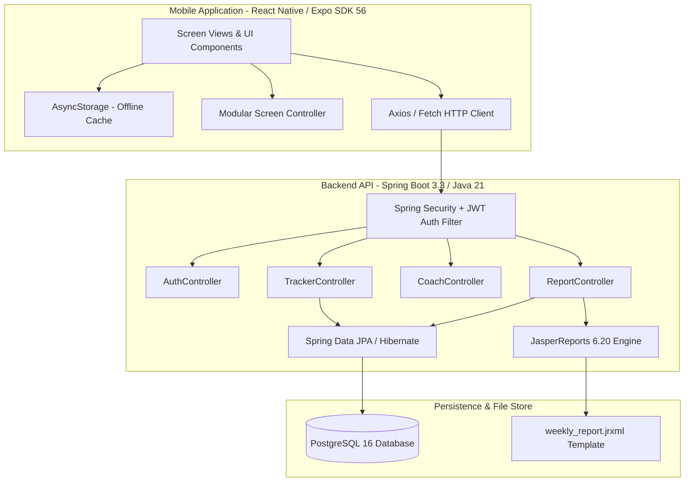
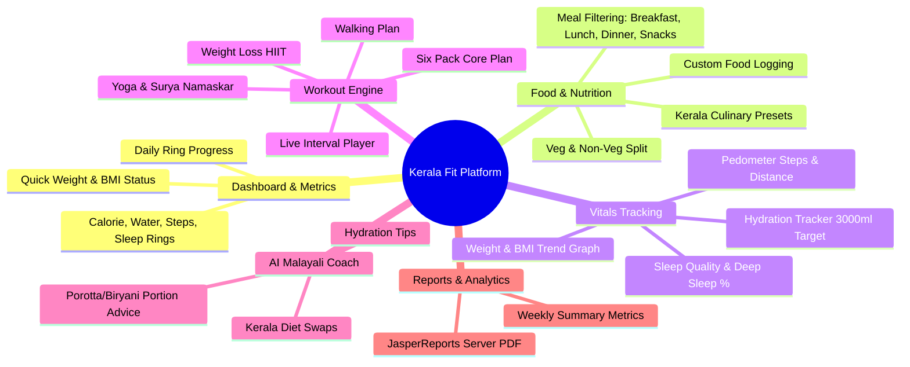
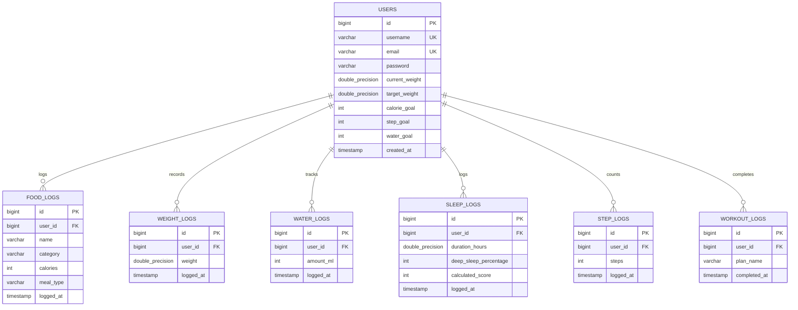
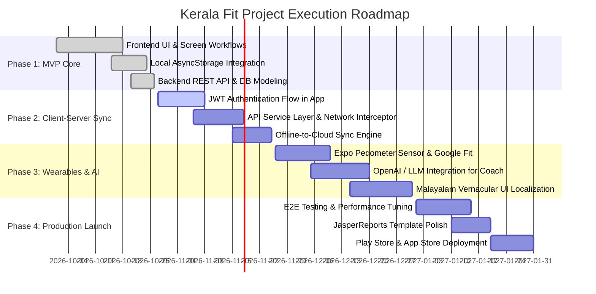

# Kerala Fit — Project Management Plan & Technical Specification

> **Version:** 1.0.0  
> **Date:** October 2026  
> **Status:** Active / In-Development  
> **Tech Stack:** React Native (Expo SDK 56), TypeScript, Spring Boot 3.3.0 (Java 21), PostgreSQL, JasperReports, JWT  

---

## 1. Executive Summary & Vision

### 1.1 Project Overview
**Kerala Fit** is a culturally tailored mobile health, fitness, and nutrition management platform specifically designed for users in Kerala and the global Malayali diaspora. While mainstream fitness applications (MyFitnessPal, HealthifyMe, Strava) offer generic international databases, they fail to accurately address Kerala's unique dietary profile (e.g., high-glycemic carbohydrates from parotta, appam, puttu, and coconut-based curries) and regional lifestyle challenges (high prevalence of Type-2 diabetes and cardiovascular metabolic conditions).

Kerala Fit bridges this gap by combining:
- A hyper-localized Kerala food database with macronutrient/calorie intelligence.
- Comprehensive vital tracking (water, sleep, weight, and pedometer steps).
- An interactive home & gym workout engine with real-time interval timers.
- An AI-powered Nutrition & Fitness Coach tuned specifically for Malayali eating habits.
- Professional, downloadable weekly PDF health audits generated server-side via JasperReports.

### 1.2 Key Objectives & Success Metrics
| Objective | Success Metric (KPI) | Target |
| :--- | :--- | :--- |
| **Nutritional Awareness** | Active daily Kerala meal logging rate | > 70% logged days per weekly active user |
| **User Engagement** | Daily Active Users / Monthly Active Users (DAU/MAU) | > 35% |
| **Physical Activity** | Weekly completed workouts / step goal achievement | > 65% of userbase reaching 8,000 steps |
| **Platform Stability** | Crash-free sessions | > 99.5% |
| **Report Generation** | JasperReports PDF delivery latency | < 1.5 seconds |

---

## 2. System Architecture

Kerala Fit follows a decoupled, mobile-first client-server architecture with an offline-first mobile client and a robust enterprise RESTful backend.

### 2.1 Technology Stack Matrix
| Layer | Technology | Version | Purpose |
| :--- | :--- | :--- | :--- |
| **Mobile Runtime** | Expo / React Native | Expo 56.0.11 / RN 0.85.3 | Cross-platform mobile development (Android & iOS) |
| **Client Language** | TypeScript | 6.0.3 | Strict type safety and predictable domain models |
| **UI Icons & Assets** | Lucide React Native / React Native SVG | 1.18.0 / 15.15.4 | Lightweight vector iconography & SVG charting |
| **Client Storage** | `@react-native-async-storage/async-storage` | 2.2.0 | Offline persistence and instant load caching |
| **Backend Runtime** | Java OpenJDK | 21 (LTS) | Modern virtual threads, pattern matching, record types |
| **Backend Framework**| Spring Boot | 3.3.0 | Production-ready RESTful microservice architecture |
| **Security & Auth** | Spring Security + JJWT | JJWT 0.12.5 | Stateless JWT bearer tokens with BCrypt password hashing |
| **Database & ORM** | PostgreSQL + Spring Data JPA | PG 16 / Hibernate 6.5 | Relational persistence, transactional integrity, JSON queries |
| **Reporting Engine** | JasperReports + OpenPDF | 6.20.0 / 1.3.30 | Vector PDF weekly audit compilation and streaming |

---

## 3. Product Scope & Functional Modules

### 3.1 Module 1: Dashboard & Progress Rings
- **Visual Progress Rings**: 4-ring SVG visualization tracking daily completion percentages for:
  - Calories consumed vs. user's daily budget (e.g., 2,000 kcal).
  - Hydration consumed vs. daily target (e.g., 3,000 ml).
  - Steps logged vs. daily target (e.g., 8,000 steps).
  - Sleep duration vs. target (e.g., 8 hours).
- **Metric Cards**: Real-time cards displaying BMI, remaining calorie allowance, active calorie burn, and recent logging activity.

### 3.2 Module 2: Kerala Food & Calorie Tracker
- **Pre-loaded Kerala Nutrition Database**:
  - *Vegetarian*: Idli, Dosa, Appam, Puttu, Kadala Curry, Sambar, Aviyal, Parippu Curry, Thoran.
  - *Non-Vegetarian*: Kerala Fish Curry, Chicken Curry, Beef Curry, Al Faham, Chicken Mandi, Malabar Biryani, Beef Fry, Egg Curry.
- **Categorization**: Filterable by meal slots (`Breakfast`, `Lunch`, `Dinner`, `Snacks`) and dietary preference (`Vegetarian`, `Non-Vegetarian`, `Other`).
- **Custom Logging**: User-entered food items with custom name and caloric value.

### 3.3 Module 3: Hydration, Sleep, Steps & Weight Trackers
- **Hydration Tracker**:
  - Quick-add buttons (+150ml tea cup, +250ml glass, +500ml bottle).
  - Dynamic visual water glass level with hydration status alerts.
  - Native health tips (e.g., drinking warm *Jeeraka Vellam*).
- **Sleep Quality Analyzer**:
  - Sleep duration logger (hours).
  - Deep sleep ratio tracking.
  - Composite sleep score calculation (0–100 score).
- **Step & Distance Pedometer**:
  - Step counter with distance conversion (km) and active burn estimation (kcal).
  - Daily progress toward 8,000–10,000 steps.
- **Weight & BMI Log**:
  - Historical weight logging with timestamp.
  - Interactive Bézier curve trend chart ([CustomChart.tsx](file:///e:/Kerala%20Fit/src/components/CustomChart.tsx)).
  - Target weight delta calculation (e.g., "4.8 kg to goal").

### 3.4 Module 4: Interactive Workout Engine
- **Pre-configured Fitness Plans**:
  1. *Walking Plan* (20 min) – Warmup stretch, Brisk Walk, Steady Walk, Cool-down.
  2. *Yoga & Mindfulness Plan* (15 min) – Pranayama, Surya Namaskar, Trikonasana, Savasana.
  3. *Weight Loss HIIT* (12 min) – Jumping Jacks, Squats, Push-ups, Mountain Climbers, Burpees.
  4. *Six Pack Core Plan* (10 min) – Crunches, Planks, Bicycle Crunches, Leg Raises.
- **Interval Player**: Modal workout runner with exercise progression, countdown timers, pause/resume, and completion logging.

### 3.5 Module 5: AI Malayali Fitness & Nutrition Coach
- **Contextual Health Guidance**: Provides culturally intelligent suggestions:
  - Smart swaps for calorie-dense items (e.g., replacing refined maida Porotta with whole-wheat Chapati; pairing Al Faham with fresh salad rather than mayo-heavy dips).
  - Portion control strategies for Feast/Sadhya and Biryani occasions.
  - Traditional wellness integration (Jeeraka Vellam, herbal decoctions, steamed breakfast traditions).

### 3.6 Module 6: JasperReports Weekly Health Audit
- **Aggregated Analytics**: Calculates 7-day averages for calories, hydration, sleep score, steps, and net weight change.
- **Automated PDF Export**: Calls `/api/reports/weekly/pdf` on the Spring Boot backend to compile a JasperReports vector PDF report using `weekly_report.jrxml`.

---

## 4. Database Architecture & Data Models

### 4.1 Relational Schema Diagram (PostgreSQL)

---

## 5. API Specification

All backend endpoints are secured with HTTP Authorization Header (`Bearer <JWT-TOKEN>`) except authentication endpoints.

| Method | Endpoint | Description | Request Body / Params | Response |
| :--- | :--- | :--- | :--- | :--- |
| `POST` | `/api/auth/register` | Register new user profile | `{ username, email, password, weightGoal, calorieGoal... }` | User entity + Status 201 |
| `POST` | `/api/auth/login` | Authenticate & obtain JWT | `{ username, password }` | `{ token, type: "Bearer", username }` |
| `GET` | `/api/tracker/dashboard` | Fetch aggregated daily metrics | None | Dashboard payload with today's totals |
| `POST` | `/api/tracker/food` | Log food consumption | `{ name, category, calories, mealType }` | Saved `FoodLog` |
| `GET` | `/api/tracker/food` | List user food logs | `?startDate=&endDate=` | `List<FoodLog>` |
| `POST` | `/api/tracker/weight` | Record weight measurement | `{ weight }` | Saved `WeightLog` |
| `POST` | `/api/tracker/water` | Log water consumption | `{ amount }` | Saved `WaterLog` |
| `POST` | `/api/tracker/sleep` | Record sleep duration & stats | `{ duration, deepSleep, score }` | Saved `SleepLog` |
| `POST` | `/api/tracker/steps` | Log step counter progress | `{ steps }` | Saved `StepLog` |
| `POST` | `/api/tracker/workouts`| Log completed workout | `{ planName }` | Saved `WorkoutLog` |
| `POST` | `/api/coach/ask` | Query AI Malayali Health Coach | `{ query: string }` | `{ response: string }` |
| `GET` | `/api/reports/weekly/pdf`| Stream compiled JasperReports PDF| None | Binary stream (`application/pdf`) |

---

## 6. Implementation Roadmap & Milestones

The project lifecycle is organized into 4 distinct phases spanning 16 weeks:

### Detailed Phase Breakdown

#### Phase 1: Foundation & Standalone Prototype *(Completed)*
- [x] Initialized Expo 56 / React Native app with TypeScript and modern dark-mode palette.
- [x] Implemented core dashboard with dynamic SVG progress rings.
- [x] Built Kerala food database and calorie tracking interface.
- [x] Built vital screens: Hydration, Weight with custom charts, Sleep score, Step counter.
- [x] Created interactive workout runner with 4 custom training routines.
- [x] Built Spring Boot 3.3 backend skeleton with PostgreSQL, JWT security, and JasperReports PDF generator.

#### Phase 2: Client-Server Integration & Network Sync *(Current Phase)*
- [ ] Implement Auth Context and secure token storage in mobile client via `expo-secure-store`.
- [ ] Connect client screens to Spring Boot `/api/tracker/*` endpoints.
- [ ] Build offline queue: cache logs locally when offline, automatically flush to backend when network reconnects.
- [ ] Connect PDF download button in [ReportsScreen.tsx](file:///e:/Kerala%20Fit/src/screens/ReportsScreen.tsx) to `/api/reports/weekly/pdf` via `expo-file-system` and `expo-sharing`.

#### Phase 3: Sensor Integrations & Advanced AI Coaching
- [ ] Integrate device hardware sensors via `expo-sensors` (Pedometer) for automated background step counting.
- [ ] Connect `CoachController` to OpenAI / Claude API with regional diet prompt engineering.
- [ ] Add bilingual support (English + Malayalam interface toggling).
- [ ] Implement push notifications for meal logging reminders and hydration alerts (`Jeeraka Vellam reminder`).

#### Phase 4: Hardening, Security Audit & Deployment
- [ ] Security hardening: Rate limiting, SQL injection safeguards, CORS origin restriction.
- [ ] Automated integration tests for Spring Boot controllers using `@SpringBootTest` and MockMvc.
- [ ] Dockerize backend microservice (`Dockerfile` + `docker-compose.yml` for Spring Boot & PostgreSQL).
- [ ] Prepare Expo Application Services (EAS Build) configurations for Android APK/AAB and iOS IPA.
- [ ] App Store and Google Play Store submission.

---

## 7. Non-Functional Requirements (NFR)

1. **Performance**:
   - App cold-start time under 1.8 seconds on standard Android/iOS hardware.
   - 60 FPS smooth rendering on charts and SVG ring animations.
   - Backend API P95 response time under 120ms (excluding PDF generation).
2. **Offline-First Resilience**:
   - The user must be able to log food, water, weight, and workouts without active internet connectivity. Logs persist in `AsyncStorage` and sync idempotently upon network restoration.
3. **Security & Privacy**:
   - Passwords salted and hashed with BCrypt (strength 12).
   - Stateless JWT tokens expiring after 24 hours.
   - User health telemetry encrypted in transit via TLS 1.3.
4. **Data Integrity & Consistency**:
   - PostgreSQL foreign key constraints cascade on user deletion.
   - ISO 8601 UTC timestamps across client and backend to prevent time zone drift.

---

## 8. Risk Management Matrix

| Risk Event | Severity | Probability | Mitigation Strategy |
| :--- | :--- | :--- | :--- |
| **Network Disruption during Workout / Logging** | High | High | Offline-first architecture using local `AsyncStorage` queue ensures zero data loss. |
| **JasperReports Heap Memory Spikes** | Medium | Medium | JasperReports compiled `.jasper` templates cached in memory; JVM tuned with appropriate `-Xmx` ceiling. |
| **Pedometer Background Battery Drain** | Medium | High | Use batch step updates rather than high-frequency GPS tracking; rely on OS-level sensor batching. |
| **Database Migration Downtime** | High | Low | Implement Flyway / Liquibase database migration scripts for atomic, version-controlled schema evolution. |
| **Cultural Recipe Caloric Variances** | Low | High | Provide standard baseline portion sizes with an intuitive custom food calorie override form. |

---

## 9. Team Structure & Governance

- **Lead Full-Stack / Mobile Architect**: Sarang S.
- **Frontend Lead**: React Native / Expo developer (State management, UI design, sensor integration).
- **Backend & DevOps Engineer**: Spring Boot, PostgreSQL, Docker, CI/CD pipeline.
- **Nutritional & Fitness Consultant**: Verification of Kerala food macro breakdowns and safe workout plans.
- **Review Cadence**: Bi-weekly sprint demos and sprint backlog prioritization.
